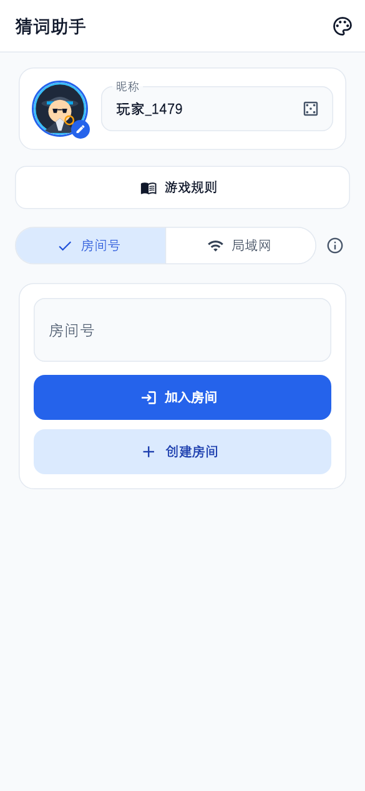
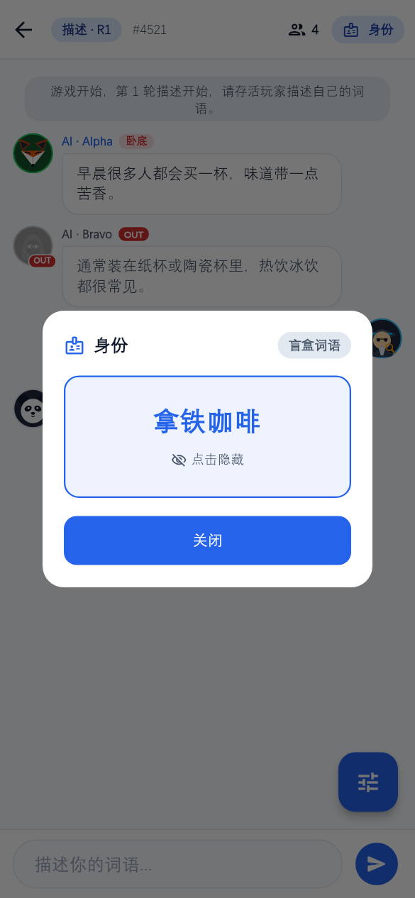
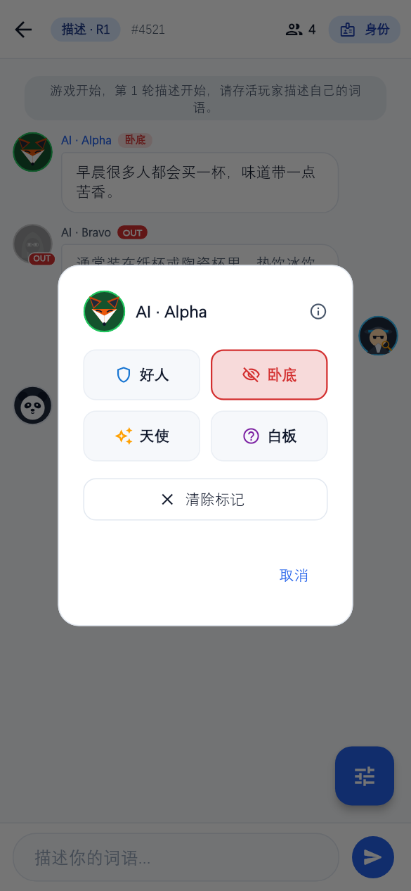
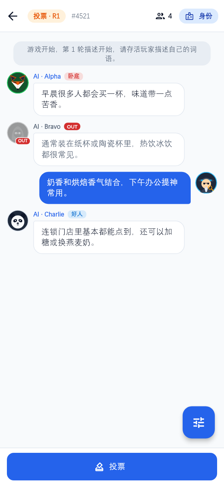
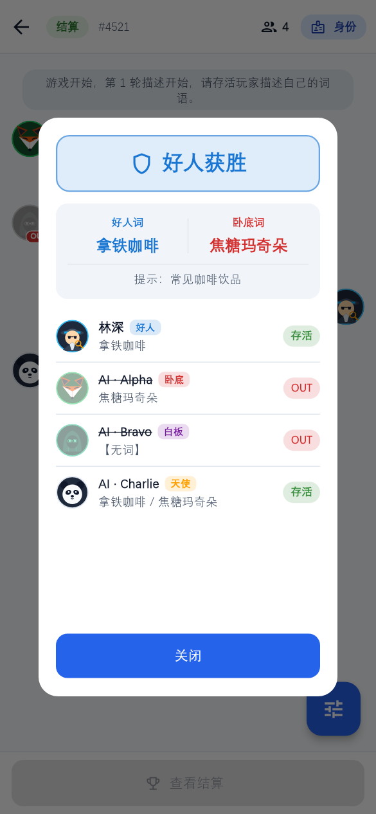
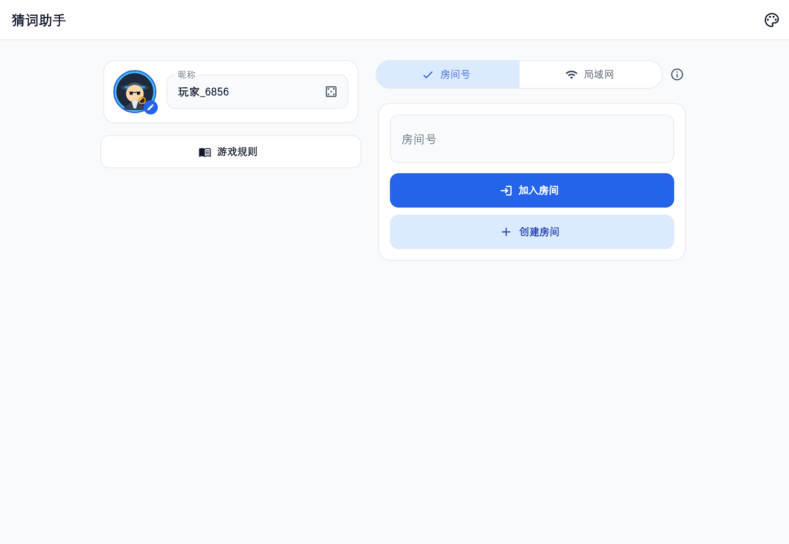
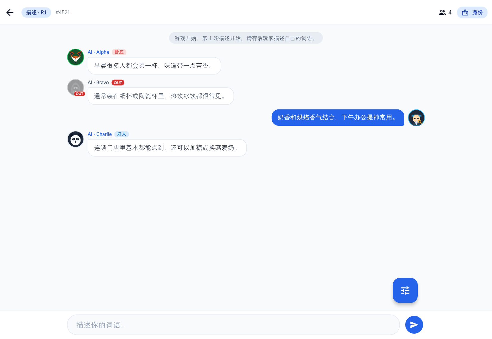
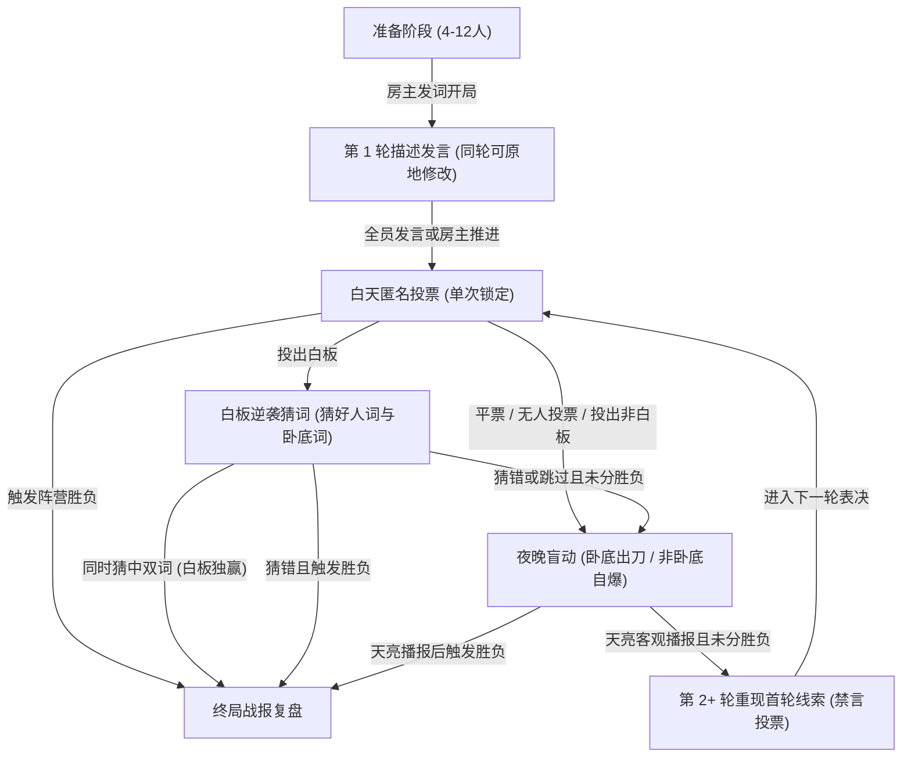

# 猜词助手 (Word Guess Assistant)

<p align="center">
  
</p>

<p align="center">
  
  
  
  
</p>

<p align="center">
  基于纯 Flutter / Dart 构建的跨平台多人社交推理猜词派对游戏，支持 4~12 人动态博弈、4 位房间号 WebRTC 跨网直连与无外网局域网 TCP 联机。
</p>

---

## 核心特性

- **移动端优先 + 全端响应式布局**：手机端提供全屏沉浸式体验，桌面与 Web 端随窗口尺寸自适应切换单/双栏布局；默认采用清爽**浅色**主题，支持 **5 套 Material 3 主题**（浅色、暗夜、赛博、深海、森林）实时热切并本地持久化。
- **全屏即时通讯式对局体验**：房间内采用纯聊天流交互，点击玩家头像即可弹出本地推理标记框，已出局玩家标记 `OUT` 并禁用操作，阶段切换自动弹窗确认，房主通过悬浮控制按钮推进流程。
- **双模联机架构**：
  - **4 位房间号（WebRTC P2P）**：全平台（含纯静态 Web）可用，基于公共 EMQX MQTT over WSS（`mqtt` 子协议，内置国际 `broker.emqx.io` / 国内 `broker-cn.emqx.io` 节点自动故障切换）与公共 STUN 服务，免公网 IP 跨网点对点直连。
  - **纯离线局域网（TCP 直连）**：桌面与移动端基于原生 `dart:io` Socket（4 字节大端帧长前缀 + UTF-8 JSON），输入房主 `IP + 端口` 即可在无外网环境下直连开黑。
- **15 款矢量 SVG 头像与内置 AI 机器人**：内置 `角色` / `动物` / `赛博` 三大分类共 15 款矢量头像供弹窗挑选；房主控制台支持一键 `+1` / `+3` / `补至8人` 填充 AI 机器人，单人即可跑通完整博弈流程。
- **权威房主引擎与防作弊脱敏**：统一纯 Dart 博弈引擎与自解析 JSON 协议（免 `protoc` 编译链），房主广播全量快照时自动擦除词对与他人的真实身份，支持断线重连恢复身份与中途加入观战。

---

## 界面预览

### 移动端主流程（默认浅色）

<table>
  <tr>
    <td align="center">
      <br />
      <sub>主界面（房间号 / 局域网切换）</sub>
    </td>
    <td align="center">
      <br />
      <sub>查看盲盒底牌词语</sub>
    </td>
    <td align="center">
      <br />
      <sub>全屏 IM 对局与描述发言</sub>
    </td>
  </tr>
  <tr>
    <td align="center">
      <br />
      <sub>点击头像本地推理标记</sub>
    </td>
    <td align="center">
      <br />
      <sub>白天匿名投票阶段</sub>
    </td>
    <td align="center">
      <br />
      <sub>终局战报与全员身份揭晓</sub>
    </td>
  </tr>
</table>

### 桌面端响应式布局与主题切换

<table>
  <tr>
    <td align="center">
      <br />
      <sub>桌面端双栏主界面</sub>
    </td>
    <td align="center">
      <br />
      <sub>桌面端浅色对局</sub>
    </td>
    <td align="center">
      <br />
      <sub>桌面端暗夜主题</sub>
    </td>
  </tr>
</table>

---

## 游戏规则与流程

### 1. 4~12 人动态身份配比

每局严格锁定 **1 名天使** 与 **1 名白板**，卧底与好人数量随总人数自动平衡：

| 总人数 | 卧底 (Spy) | 天使 (Angel) | 白板 (Blank) | 好人 (Good) |
| :---: | :---: | :---: | :---: | :---: |
| **4 人** | 1 | 1 | 1 | 1 |
| **5 人** | 1 | 1 | 1 | 2 |
| **6 人** | 2 | 1 | 1 | 2 |
| **7 人** | 2 | 1 | 1 | 3 |
| **8 人** | 2 | 1 | 1 | 4 |
| **9 人** | 3 | 1 | 1 | 4 |
| **10 人** | 3 | 1 | 1 | 5 |
| **11 人** | 3 | 1 | 1 | 6 |
| **12 人** | 4 | 1 | 1 | 6 |

### 2. 核心玩法机制

1. **准备阶段与盲盒发词**：
   - **好人 / 卧底**：发词后仅展示各自底牌词语，身份区统一为盲盒隐藏，无法直接获知自己所属阵营。
   - **天使**：同时看到好人词与卧底词（顺序随机打乱），需在不暴露身份的前提下暗中引导好人。
   - **白板**：全程无底牌词，仅获得题目方向提示，需通过他人的描述伪装融入。
2. **第 1 轮描述发言**：所有存活玩家在聊天流中提交首轮线索描述；同轮内再次发送将**原地修改**自己的首轮发言，避免刷屏。
3. **白天匿名投票**：存活玩家各自选择 1 名目标投票，**单次提交即锁定**；系统仅向投票本人返回私密回执，不在公共频道刷屏播报进度。单人最高票者出局，平票或无人投票则无人出局并直接入夜。
4. **白板逆袭**：若白板在白天被投票出局，立即进入「白板猜词」阶段；白板需同时输入好人词与卧底词（不限顺序），**双词全部命中则白板立即独赢**，猜错或跳过则彻底出局并延续对局。
5. **夜晚盲动与自爆**：进入夜晚后，所有存活玩家均可点击夜间行动（每夜限一次）：卧底出刀可淘汰目标；好人、天使或白板在夜晚误操作提交行动将触发**自爆**。夜间行动结果统一延迟至**天亮时客观播报出局名单**，绝不泄露死因。
6. **第 2 轮起复盘线索**：从第 2 轮起禁言不再重新描述，系统在天亮播报后自动重现所有玩家的第 1 轮线索，直接推进下一轮表决。
7. **胜负判定**：
   - **好人获胜**：所有卧底出局，且白板已出局。
   - **卧底获胜**：存活卧底数 ≥ 存活好人数（含天使），或场上总存活 ≤ 2 人且仍有卧底。
   - **白板获胜**：白天被投出后同时猜中双词，或场上好人与卧底全部出局、白板作为唯一阵营存活。
8. **终局战报复盘**：对局结束后弹出战报弹窗，完整揭晓好人词、卧底词、方向提示与全员真实身份。

### 3. 状态机流转图



---

## 项目结构

```text
assets/
├── avatars/                           # 15 款矢量 SVG 头像（characters / animals / cyber）
└── screenshots/                       # README 展示用界面与对局截图（不打包进应用体积）

lib/
├── main.dart                          # 应用入口、Riverpod 注入与自适应窗口/主题装配
├── models/
│   ├── game_models.dart               # 阶段枚举、角色常量、Player、IdentityAssignment 与战报模型
│   ├── protocol_messages.dart         # 4 字节帧长前缀 + UTF-8 JSON 统一编解码与消息信封
│   └── word_bank.dart                 # 内置 27 组双词题库（7 大主题分类、2 档相似度）
├── core/
│   ├── game_engine.dart               # 纯 Dart 权威博弈引擎（配比/盲盒/公投/逆袭/夜间/胜负/脱敏）
│   └── mock_bots.dart                 # 虚拟 AI 玩家生成与自动发言/投票/夜晚行动/猜词模拟
├── network/
│   ├── game_transport.dart            # 抽象双工传输接口（Host / Client）
│   ├── lan/
│   │   ├── lan_transport.dart         # 条件导出入口（自动隔离 Web 与原生 dart:io）
│   │   ├── lan_transport_stub.dart    # Web 端占位降级实现
│   │   ├── lan_transport_io.dart      # 原生 TCP 4 字节帧头 Server / Client
│   │   └── lan_discovery_io.dart      # 原生局域网 UDP 辅助发现模块
│   └── p2p/
│       ├── mini_mqtt_client.dart      # 纯 Dart WebSocket MQTT 3.1.1 客户端（mqtt 子协议与 SUBACK 确认）
│       ├── p2p_signaling.dart         # 4 位房间号信令调度（EMQX 国际/国内故障切换）
│       └── webrtc_transport.dart      # 基于 flutter_webrtc 的星型拓扑 DataChannel 传输与 ICE 队列
├── controllers/
│   ├── game_controller.dart           # Riverpod 房间调度中枢（建房/重连/观战/首轮修改与线索重现）
│   └── theme_controller.dart          # Material 3 5 套主题管理（默认浅色）与持久化
└── ui/
    ├── screens/
    │   ├── home_screen.dart           # 大厅页面（头像昵称、规则入口、房间号/局域网模式切换）
    │   └── room_screen.dart           # 全屏 IM 聊天室对局界面（响应式单/双栏、阶段栏、房主 FAB）
    ├── widgets/
    │   └── avatar_widget.dart         # 15 款矢量 SVG 头像渲染与 OUT 灰度徽章
    └── modals/
        ├── avatar_picker_dialog.dart  # 分类头像选择弹窗（角色 / 动物 / 赛博）
        ├── blank_guess_dialog.dart    # 白板双词逆袭猜词弹窗
        ├── host_console_dialog.dart   # 房主控制台（主题相似度筛选、开局、推进、机器人填充）
        ├── identity_card_dialog.dart  # 个人底牌与词语查看弹窗
        ├── night_action_dialog.dart   # 夜晚行动目标选择弹窗
        ├── phase_notice_dialog.dart   # 阶段切换自动确认提示弹窗
        ├── player_mark_dialog.dart    # 点击头像本地身份推理标记弹窗
        ├── player_roster_sheet.dart   # 房间玩家列表与标记状态抽屉
        ├── rule_dialog.dart           # 简洁游戏规则弹窗
        ├── settlement_dialog.dart     # 终局战报全员底牌揭晓弹窗
        ├── theme_picker_dialog.dart   # 5 套主题实时切换面板
        └── vote_dialog.dart           # 白天匿名投票弹窗

test/
├── game_controller_flow_test.dart     # 控制器状态流、首轮修改与线索重现测试
├── game_engine_test.dart              # 博弈引擎规则、白板逆袭与夜晚自爆脱敏测试
├── lan_socket_test.dart               # 原生 TCP 粘包/半包编解码与本地环回测试
├── mock_bots_game_flow_test.dart      # AI 机器人增量生成与完整对局闭环测试
├── p2p_and_security_test.dart         # MQTT 协议包、故障切换与快照防作弊脱敏测试
├── theme_and_avatar_test.dart         # 默认浅色主题、5 套配色与 15 款 SVG 资源测试
├── visual_audit_test.dart             # 移动端与桌面端响应式视觉渲染测试
└── widget_test.dart                   # 主界面与弹窗交互组件测试
```

---

## 快速开始与多平台构建

### 1. 环境要求

- **Flutter 3.x** 与 **Dart 3.x**（`pubspec.yaml` 要求 `sdk: ^3.13.7`）
- 对应目标平台的原生编译工具链（如 Linux GTK3、Android SDK、Windows MSVC 等）

### 2. 拉取代码与安装依赖

```bash
git clone https://github.com/TfiyuenLau/Word-Guess-Assistant-Flutter.git
cd Word-Guess-Assistant-Flutter

# 国内网络环境可选配置官方镜像
export PUB_HOSTED_URL="https://pub.flutter-io.cn"
export FLUTTER_STORAGE_BASE_URL="https://storage.flutter-io.cn"

flutter pub get
```

### 3. 静态分析与自动化测试

```bash
flutter analyze
flutter test
```

### 4. 多平台运行与打包

- **Linux 桌面端**

  ```bash
  flutter run -d linux
  flutter build linux --release
  # 构建产物位于 build/linux/x64/release/bundle/word_guess_assistant_flutter
  ```

- **Web 端（纯静态部署，支持 4 位房间号 WebRTC P2P）**

  ```bash
  flutter run -d web-server --web-port 8080
  flutter build web --release
  # 构建产物位于 build/web/
  ```

- **Android 移动端**

  ```bash
  flutter build apk --release
  # 构建产物位于 build/app/outputs/flutter-apk/app-release.apk
  ```

- **Windows 桌面端**

  ```bash
  flutter run -d windows
  flutter build windows --release
  ```

---

## 常见问题 (FAQ)

### Q1: Linux 编译时报错找不到 GTK 或 `libwebrtc.so` 等系统库？

若环境中激活了 Conda 或 CUDA 工具链，其自带的 `x86_64-conda-linux-gnu-ld` 可能会接管默认链接器并忽略系统库路径。项目的 [`linux/CMakeLists.txt`](linux/CMakeLists.txt) 已自动检测 `/usr/bin/ld` 并注入 `-fuse-ld=/usr/bin/ld`，通常无需手动修改 `PATH` 即可正常编译。

### Q2: 局域网直连无法连上房间怎么办？

1. 请确保房主与所有玩家处于同一局域网网段，且未开启公共 Wi-Fi 的 **AP 隔离（Client Isolation）**；
2. 检查房主设备系统防火墙是否放行了设定的 TCP 端口（默认 `8888`）；
3. 户外或聚会无路由器时，可由房主开启手机个人热点供他人连接后输入热点分配的局域网 IP，或直接切换至 **4 位房间号（WebRTC P2P）** 模式跨网直连。

### Q3: WebRTC P2P 模式建立房间失败或信令连接超时？

P2P 模式默认优先连接公共节点 `wss://broker.emqx.io:8084/mqtt`，失败时会自动切换至国内备用节点 `wss://broker-cn.emqx.io:8084/mqtt`；若处于严格限制 WSS 或 UDP 打洞的企业/校园内网，可尝试更换网络环境或在同局域网下使用 **局域网 TCP 直连** 模式。

---

## 开源协议

本项目基于 MIT License 开源，欢迎提交 Issue 与 Pull Request。
